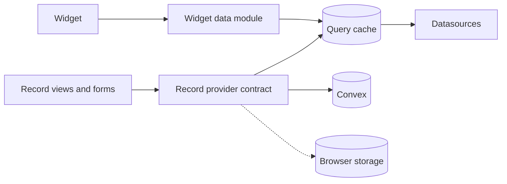

# Target architecture

How the builder should be put together after the restructure. [current-state.md](../current-state.md) describes the app as it is today; this page describes where it is going. The contracts are in [contracts.md](contracts.md).

## In short

- The builder shows data in widgets and, new, lets apps built on it edit records.
- Reading data for widgets keeps its current shape, with clearer rules about who fetches and when.
- Editing records gets its own contract. Convex is the first place records are stored; browser storage is the second, and the user can switch in the options.
- Plugins stay chosen at build time. More kinds of things can be plugged in, and a widget describes itself more fully.
- Most of this is tightening what exists, not replacing it.

## What stays and what changes

| Area              | Stays                                                                 | Changes                                                                                                                                                    |
| ----------------- | --------------------------------------------------------------------- | ---------------------------------------------------------------------------------------------------------------------------------------------------------- |
| Widget data       | The query cache owns every query; identical queries share one request | One module becomes the only way a widget gets data. The first screen starts from the route. Data stays fresh until the query changes or the user refreshes |
| Record data       | Nothing exists today                                                  | A record provider contract, with Convex and browser storage behind it                                                                                      |
| Plugins           | Static lists chosen at build time                                     | New kinds: context-bar panels, actions, record providers. A widget declares its options editor, accepted query types and metadata                          |
| Isolation         | An error boundary per tile and schema checks                          | Loading a widget's code is retried on failure                                                                                                              |
| State             | One store per open dashboard; undo and drafts                         | The URL always owns the time range                                                                                                                         |
| Charts            | The chart library is chosen inside each widget plugin                 | ECharts becomes the default; the Recharts widget stays as a second renderer                                                                                |
| Dashboard layout  | One flat grid, same column counts                                     | The double layout at a breakpoint is fixed. Rows, tabs or sections come right after the restructure                                                        |
| Saving dashboards | Version number, upgrade step by step on read                          | Dashboards are saved through the record provider, so they follow the storage setting                                                                       |
| Context bar       | Route-declared tabs                                                   | A page can also render live content into it                                                                                                                |
| Option editors    | Options are edited as JSON today                                      | Generated from the options schema by field type; a widget can supply its own                                                                               |
| Motion            | Tokens and CSS for the shell and widgets                              | A motion library only inside features that need layout animation. Panels slide with their content frozen                                                   |

## Two kinds of data

The builder now has two data paths. Keeping them apart is the main structural rule.

|              | Query data                                                  | Record data                                          |
| ------------ | ----------------------------------------------------------- | ---------------------------------------------------- |
| What it is   | Frames for charts, numbers and tables                       | Rows an app creates, edits and deletes               |
| Comes from   | Datasources (mock, local JSON, databases through the relay) | A record provider (Convex or browser storage)        |
| Direction    | Read only                                                   | Read and write                                       |
| Contract     | Datasource and widget data                                  | Record provider                                      |
| Changes when | The query changes or the user refreshes                     | A write happens, or a live provider pushes an update |

## Rules

Each rule comes from one decision. The number in brackets is the decision.

1. **One way to get widget data.** Widgets and features never call a datasource themselves; they go through the widget data module. A lint rule and tests keep it that way. (D1.1)
2. **The route starts the first screen.** It starts the queries for the widgets visible on load and does not wait for them. Widgets further down start when they come near the viewport. (D1.2)
3. **Code and data load side by side.** A widget's code does not wait for its data. (D1.2)
4. **Fresh until asked.** Dashboard query results change only when the query changes, the user refreshes, or the refresh timer fires. (D1.3)
5. **Records go through a provider.** No feature talks to Convex or browser storage directly. (D1.4)
6. **Where records are saved is a setting.** A provider says what it supports; an unsupported operation says so instead of failing silently. (D1.4)
7. **Plugins are static lists.** A plugin is one definition that lists what it contributes, so it can later gain setup and start steps without changing its shape. (D2.1)
8. **Definitions are light, code is lazy.** Listing or describing a plugin never loads its code. (D2.3)
9. **One store per open dashboard.** Each tile reads only its own slice. (D3.1)
10. **The URL owns the time range**, in view mode and in edit mode. (D3.2)
11. **No shared chart layer.** A chart library lives inside a widget plugin; another library is another widget. (D4.1, D4.2)
12. **One storage path.** Dashboards and other saved definitions go through the record provider, like records. (D6.2)
13. **Definitions follow a standard schema format**, not an ad-hoc one. Collection fields are stored as data and edited in Studio. (D6.3, D6.4)
14. **Editors come from the schema.** A hand-written editor is the exception. (D6.1)
15. **Layout is not animated.** Panels slide with their content frozen, so content lays out once. (D7.3)
16. **A motion library is local to a feature**, never app-wide. (D7.1)

## Not decided

| Item                                                                | State                                                                                                                                    |
| ------------------------------------------------------------------- | ---------------------------------------------------------------------------------------------------------------------------------------- |
| Memoization policy (D3.3)                                           | Deferred until renders are measured                                                                                                      |
| A server-side result cache (D1.5)                                   | Deferred                                                                                                                                 |
| What resizable panels are built on (D5.3)                           | Deferred; work starts only after everything else is done                                                                                 |
| Workspace tabs, several records open at once (D5.2)                 | Not in the restructure. An own tab strip when the rehab app's record views start; the URL must be able to name more than one open record |
| The reduced-motion rule (D7.2)                                      | Opt-in per rule is the target, deferred; the first step is done with Motion                                                              |
| Dashboard variables (D4.5), View Transitions (D7.4)                 | Deferred                                                                                                                                 |
| Which standard the definition format follows (D6.4)                 | Open: a standard is required, the specific one is not picked                                                                             |
| How panels behave until D5.3 is done (D7.3)                         | Open: the frozen slide came with the panel library in the spike                                                                          |
| When TanStack DB sits behind the record contract                    | Open. The contract does not depend on it                                                                                                 |
| Whether Convex's query adapter coexists with the datasource queries | To check before the Convex provider is built                                                                                             |

## What the restructure has to look at

Areas to review and rethink, in this order. Concrete steps are written next to the work, not here.

1. Widget data: make one module the single entry, and add the rule that keeps it so.
2. Where fetching starts: the dashboard route and the tile.
3. Freshness defaults for dashboard queries, and how refresh interacts with them.
4. Time range: remove the second owner.
5. The widget definition: editor, accepted query types, metadata, retry.
6. Plugin registries: add the three new kinds; reject duplicates.
7. The record provider contract, then the browser-storage provider, then the Convex provider.
8. The storage setting, with export and import.
9. Dashboards saved through the record provider.
10. The chart widget: ECharts as the default renderer, Recharts kept as a second one.
11. The grid's double layout at a breakpoint.
12. Option editors generated from the schema.
13. Live content in the context bar.
14. Last: resizable panels, and with them how panels open and close.
